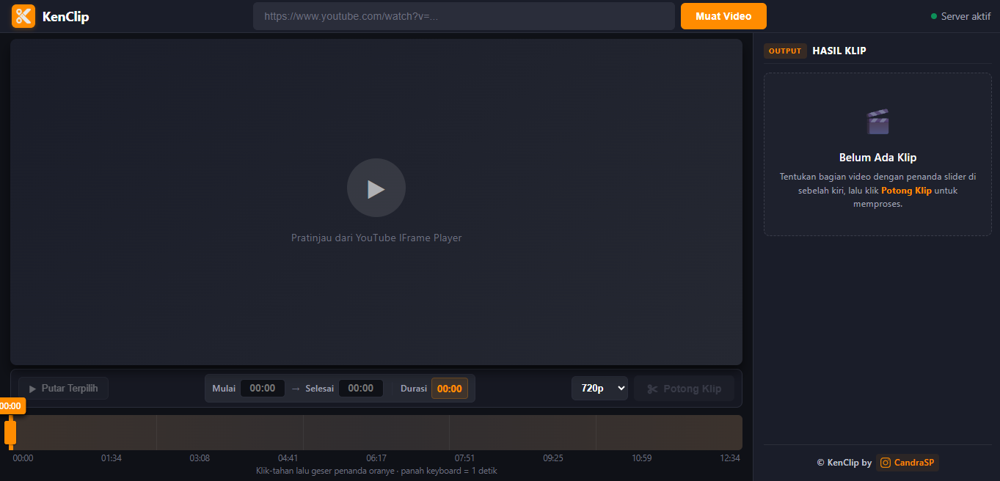

# ✂️ KenClip - YouTube Video Clipper

Aplikasi web modern, cepat, dan ringan berbasis **Bun & Hono** untuk memotong dan mengunduh klip video dari YouTube secara presisi tanpa harus mengunduh video utuh.



---

## ✨ Fitur Utama

- ⚡ **Pemotongan Cepat (Instant Clipping)** - Memanfaatkan fitur `--download-sections` dari `yt-dlp`. Video berdurasi 1 jam hanya diunduh pada segmen detik yang Anda potong saja, menghemat kuota & bandwidth secara drastis.
- 🎯 **Presisi Titik Potong Tinggi** - Didukung `--force-keyframes-at-cuts` serta tombol cepat `📌 Mulai` & `📌 Selesai` langsung dari posisi pemutaran video saat ini.
- 🔍 **Timeline Zoom (<kbd>Ctrl</kbd> + Scroll)** - Zoom in/out timeline untuk memotong durasi beberapa detik pada video panjang (30+ menit) dengan sangat mudah dan presisi, dilengkapi proteksi zoom browser dan tombol *Reset Zoom*.
- 📐 **Konversi Aspek Rasio (On-Demand)** - Ubah rasio klip video lokal ke format media sosial secara instan:
  - `9:16 Shorts (Center Crop)`
  - `9:16 Shorts (Blur Background)`
  - `1:1 Square (Instagram Feed)`
- 💾 **Menu Dropdown Simpan Terpadu**:
  - `🎬 Video Normal (Ada Suara)`
  - `🔇 Video Bisu (Tanpa Suara)` - Menghapus trek audio secara instan tanpa render ulang (`-c:v copy -an`).
  - `🎵 Hanya Audio mp3` - Mengekstrak audio berkualitas tinggi (`libmp3lame`) on-demand.
- ⚙️ **Pengaturan Folder Penyimpanan Lokal** - Tentukan lokasi folder penyimpanan khusus untuk Video dan Audio via dialog native Windows File Explorer serta tombol satu-klik buka Windows Explorer.
- 🎥 **Sistem Resolusi Adaptif** - Opsi resolusi ekspor (1080p, 720p, 480p, 360p) otomatis menyesuaikan ketersediaan kualitas video sumber di YouTube.
- 🛡️ **Quality & Security Protection**:
  - Validasi ketat domain YouTube & regex nama file aman (`Anti Path-Traversal`).
  - Proteksi eksekusi argumen `Bun.spawn` murni (`Anti Command-Injection`).
  - Proteksi video kualitas buruk (≤ 240p) agar hasil klip tetap layak ditonton.
- 🧹 **Auto-Cleanup Konfigurabel** - File klip lama di folder `clips/` otomatis dibersihkan setiap 15 menit (dapat diaktifkan/dinonaktifkan di menu pengaturan).
- 🎨 **Tampilan Gelap Modern (Full-Width Desktop Optimized)** - Didesain pas 1 layar penuh (khususnya rasio 1366×768 / 1080p), dilengkapi sistem **Toast Notifications** dan **Confirmation Modal Dialog** estetis.

---

## 🚀 Cara Menggunakan

1. **Masukkan URL YouTube**:
   - Tempel link video YouTube (mendukung format `watch?v=`, `shorts/`, atau `youtu.be/`).
   - Klik tombol **Muat Video** (video langsung termuat instan < 0.2 detik).
2. **Tentukan Rentang Waktu Klip**:
   - Geser penanda slider oranye di timeline, gunakan <kbd>Ctrl</kbd> + Scroll untuk memperbesar timeline jika video panjang.
   - Atau gunakan tombol cepat `📌 Mulai` / `📌 Selesai` saat video diputar ke detik yang diinginkan.
3. **Validasi & Eksekusi Potong**:
   - Klik tombol **▶ Putar Terpilih** untuk mempratinjau bagian video yang dipilih.
   - Pilih kualitas dari dropdown resolusi yang otomatis aktif (1080p, 720p, 480p, atau 360p).
   - Klik **✂ Potong Klip**.
4. **Kelola Hasil Klip di Sidebar**:
   - **💾 Simpan Video / Audio ▾**:
     - *Video Normal (Ada Suara)*: Simpan klip MP4 utuh.
     - *Video Bisu (Tanpa Suara)*: Simpan video tanpa suara.
     - *Hanya Audio mp3*: Ekstrak dan simpan audio saja.
   - **📐 Aspek Rasio**: Pilih format `9:16 Shorts (Crop/Blur)` atau `1:1 Square` lalu klik **Terapkan**.
   - **⚙️ Pengaturan**: Klik ikon gerigi di header sidebar untuk mengatur direktori folder penyimpanan default.

---

## 🎥 Sistem Resolusi Adaptif

KenClip menggunakan pemindaian format di latar belakang *(non-blocking)* sehingga tidak memperlambat pemuatan player utama:

| Resolusi Maksimal Video Sumber | Opsi Dropdown yang Ditampilkan |
| :--- | :--- |
| **Tersedia 1080p (Full HD)** | `1080p`, `720p` *(default)*, `480p`, `360p` |
| **Maksimal 720p (HD)** | `720p` *(default)*, `480p`, `360p` (1080p disembunyikan) |
| **Maksimal 480p (SD)** | `480p`, `360p` |
| **Maksimal 360p** | `360p` |
| **Sangat Rendah (≤ 240p)** | Muncul peringatan error & tombol potong dinonaktifkan |

---

## 📋 Prasyarat Sistem

Pastikan binary berikut telah terpasang di sistem dan terdaftar pada PATH lingkungan:

- [Bun](https://bun.sh/) (v1.0 ke atas)
- [yt-dlp](https://github.com/yt-dlp/yt-dlp) (versi terbaru, disarankan `yt-dlp -U`)
- [FFmpeg](https://ffmpeg.org/) (digunakan untuk muxing stream, crop aspek rasio, mute, & konversi MP3)

> Panduan instalasi external binary:
> - [INSTALL_FFMPEG.md](INSTALL_FFMPEG.md)
> - [INSTALL_YTDLP.md](INSTALL_YTDLP.md)

---

## 📦 Instalasi & Menjalankan

1. Clone repositori:
   ```bash
   git clone https://github.com/CandraSP/KenClip.git
   cd KenClip
   ```

2. Pasang dependensi:
   ```bash
   bun install
   ```

3. Jalankan aplikasi:
   - **Mode Development (Hot-Reload)**:
     ```bash
     bun run dev
     ```
   - **Mode Production**:
     ```bash
     bun start
     ```

4. Buka di browser favorit Anda: `http://localhost:57777`

---

## 📁 Struktur Direktori

```text
KenClip/
├── clips/                # Direktori penyimpanan file klip sementara (.mp4 / .mp3)
├── kenclip.config.json   # Konfigurasi lokal (folder penyimpanan & preferensi)
├── src/
│   ├── index.ts          # Server backend (Hono + Bun.spawn CLI controller)
│   └── public/           # Frontend Web Application
│       ├── index.html    # Layout UI & player markup
│       ├── style.css     # Styling Dark Mode responsif (1366x768 optimized)
│       ├── script.js     # Logika timeline, IFrame API, & eksekusi klip
│       ├── settings.js   # Modul pengaturan folder & dialog Windows
│       └── logo.svg      # Logo vektor resmi KenClip
├── package.json          # Manifest dependensi & scripts
├── ROADMAP.md            # Catatan rencana pengembangan fitur mendatang
└── README.md             # Dokumentasi proyek
```

---

## 🔌 API Endpoints

- `POST /api/video-info` - Mengambil info judul & thumbnail video instan via YouTube oEmbed API.
- `POST /api/video-quality` - Memindai daftar kualitas maksimal video sumber di latar belakang.
- `POST /api/clip` - Memotong segmen video dengan `yt-dlp` sesuai durasi dan resolusi pilihan.
- `POST /api/convert-aspect` - Mengubah aspek rasio video lokal (9:16 Crop/Blur, 1:1 Square) via FFmpeg.
- `POST /api/extract-audio` - Mengekstrak audio klip lokal ke format MP3 on-demand.
- `POST /api/mute-video` - Menghapus trek audio dari video secara instan tanpa render ulang.
- `GET /api/settings` & `POST /api/settings` - Mengambil dan memperbarui konfigurasi penyimpanan.
- `POST /api/select-folder/video` & `/audio` - Membuka dialog pemilih folder native Windows File Explorer.
- `POST /api/open-folder` - Membuka direktori penyimpanan di Windows Explorer.
- `POST /api/save-to-custom-dir` - Menyalin file klip ke folder custom pengguna.
- `GET /api/download/:filename` - Streaming/unduh file klip MP4/MP3 (didukung HTTP range).
- `DELETE /api/clip/:filename` - Menghapus file klip dari server lokal.
- `POST /api/shutdown` - Menghentikan server lokal secara aman.

---

## 👨‍💻 Developer & Attribution

© **KenClip** by [CandraSP](https://www.instagram.com/kenvanoprabowo/)  
Instagram: [@kenvanoprabowo](https://www.instagram.com/kenvanoprabowo/)

---

## 📄 Lisensi

Proyek ini dilisensikan di bawah lisensi [MIT](LICENSE).
